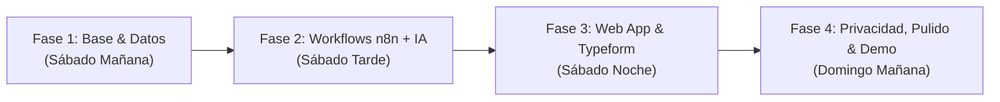

# Planificación del Proyecto y Arquitectura Técnica — Reto Estrella Damm (UAB THE HACK! 2026)

> **Proyecto:** Plataforma de Escucha Activa Continua e Inteligente para Damm  
> **Stack Core:** Web Base (Frontend RRHH & Dashboard) + **n8n** (Motor de Orquestación, IA y Pipelines de Datos) + **Typeform API** + **LLMs (Gemini / OpenAI / Ollama)** + Base de Datos Local (SQLite / JSON Store).

---

## 1. Visión Arquitectónica

Para resolver las tres tensiones del reto (**Participación**, **Personalización** y **Análisis/Acción**) dentro de un único flujo continuo y auditable, diseñamos una arquitectura desacoplada en dos capas principales:

1. **Web Base (Portal de People & Analytics Dashboard):** Interfaz web ligera, rápida y centrada en la experiencia de usuario de RRHH y Responsables de Equipo. Gestiona el *Human-in-the-Loop* (validación humana antes de publicar y antes de actuar), el generador de carteles QR para planta/logística y la visualización agregada con protección de privacidad ($k$-anonimato).
2. **Motor Backend y Automatización en `n8n` (gestionado vía `mcp-n8n-local`):** Toda la lógica de negocio, llamadas a modelos de IA, anonimización de PII, integración con la API de Typeform, cálculo de representatividad, clustering semántico de comentarios y conectores con **Microsoft 365 (Teams/Outlook)** se ejecutan como workflows modulares en **n8n**.

### Diagrama de Arquitectura del Ciclo Continuo

```mermaid
flowchart TD
    subgraph WebBase ["💻 Web Base (Portal RRHH & Dashboard)"]
        UI1["1. Definir Necesidad<br/>(Lenguaje Natural + Colectivo)"]
        UI3["3. Validación Humana<br/>(Editar / Aprobar Preguntas)"]
        UI5["5. Kit de Difusión<br/>(Cartel QR Planta / Link Móvil)"]
        UI7["7. Dashboard People Analytics<br/>(Agregación k≥5, Sesgos, Temas)"]
        UI8["8. Plan de Acción y Seguimiento<br/>(Aprobar Acción + Nueva Consulta)"]
    end

    subgraph n8nEngine ["⚙️ Orquestador Backend n8n (localhost:5678)"]
        WF1["WF-01: Diseñador IA<br/>de Microconsultas"]
        WF2["WF-02: Publicador Typeform<br/>& Conector Microsoft Teams"]
        WF3["WF-03: Ingesta, Sanitización PII<br/>& Análisis NLP / Clustering"]
        WF4["WF-04: Motor de Insights,<br/>Alertas de Sesgo y Acciones"]
    end

    subgraph External ["🌐 Servicios Externos y Datos"]
        TF["Typeform API<br/>(Formularios y Respuestas)"]
        LLM["Motor IA (LLM)<br/>(Generación, PII, Clustering)"]
        M365["Microsoft 365 / Teams<br/>(Distribución y Alertas)"]
        DB[("Almacén de Datos Sintéticos<br/>(300–1.000 respuestas, 2 períodos)")]
    end

    UI1 -->|Webhook POST| WF1
    WF1 <-->|Prompt Adaptado| LLM
    WF1 -->|Borrador JSON| UI3
    UI3 -->|Aprobación Humana| WF2
    WF2 -->|POST /forms| TF
    WF2 -->|Notificación / Card| M365
    WF2 -->|URL + QR| UI5
    TF -->|Respuestas API / Webhook| WF3
    DB -->|Carga Masiva Escenario C| WF3
    WF3 <-->|Anonimización PII + NLP| LLM
    WF3 -->|Datos Agregados y Limpios| WF4
    WF4 <-->|Detección Señales Débiles| LLM
    WF4 -->|JSON Agregado (k≥5)| UI7
    UI7 --> UI8
    UI8 -->|Cerrar Ciclo: Nueva Consulta| UI1
```

---

## 2. Diseño de Módulos de la Web Base (Frontend)

La aplicación web unifica los **8 pasos del flujo funcional mínimo** en 4 vistas conectadas:

### Módulo 1: Estudio de Creación y Validación (*Pasos 1, 2 y 3*)
- **Formulario de Necesidad en Lenguaje Natural:**
  - Campo de texto libre para RRHH (ej. *"Quiero entender cómo está afectando el nuevo sistema de turnos en planta, en menos de 2 minutos"*).
  - Selectores rápidos: Colectivo (`Planta`, `Logística`, `Comercial`, `Oficina`, `Manager`), Dimensión de clima (`Bienestar`, `Liderazgo`, `Desarrollo`, `Cultura`, `Entorno`, `Condiciones`), Idioma (`Català` / `Castellano` / `Bilingüe`) y Restricciones (*qué no preguntar*).
- **Editor Interactivo *Human-in-the-Loop*:**
  - Muestra la propuesta devuelta por `n8n` (título, mensaje de transparencia/privacidad, 3–6 preguntas, tipo de escala, lógica condicional y tiempo estimado en segundos).
  - Permite **editar enunciados, eliminar o reordenar preguntas** y exige marcar el check de **Validación Humana de RRHH** para habilitar el botón `"Publicar en Typeform"`.

### Módulo 2: Hub de Participación y Accesibilidad sin Ordenador (*Pasos 4 y 5*)
- **Generador de Cartel QR para Planta y Logística (Escenario B):**
  - Tras publicar vía API en Typeform, genera automáticamente una tarjeta/póster lista para imprimir o proyectar en pantallas de fábrica con el código QR, el tiempo estimado (`< 90 seg`) y el compromiso de anonimato.
- **Integración M365 / Teams y Control de Fatiga:**
  - Botón para disparar la distribución simulada en canales de Microsoft Teams o correo según el colectivo.
- **Monitor de Representatividad en Tiempo Real:**
  - Semáforo de cobertura que compara respuestas recibidas frente a la distribución real del colectivo y emite alertas tempranas (ej. *"⚠️ Sesgo de cobertura detectado: El turno de noche en Fàbrica representa solo el 6% de las respuestas"*).

### Módulo 3: Dashboard de Clima, Privacidad y Explicabilidad (*Pasos 6 y 7*)
- **Guardia de Privacidad ($k$-Anonimato Activo):**
  - Selector de filtros por `Período` (`T1 - Septiembre` vs `T2 - Octubre`), `Colectivo`, `Tipo de Centro` y `Canal`.
  - Si cualquier combinación filtrada arroja $N < 5$ respuestas (o el umbral configurado), la interfaz **oculta automáticamente las gráficas y comentarios** mostrando un escudo de protección de privacidad.
- **Visualizaciones Clave:**
  - **KPIs Superiores:** Participación total ($N$), Índice de Representatividad (%), Puntuación Media de Clima (con variación $\Delta$ respecto al período anterior) y Alertas Activas.
  - **Mapa de Temas y Clustering IA:** Burbujas/barras con los temas detectados en los comentarios abiertos (`Turnos`, `Comunicación`, `Herramientas`, `Cargas de trabajo`, `Liderazgo`), sentimiento asociado y **detección de señales débiles / temas emergentes**.
  - **Visor de Comentarios Sanitizados:** Muestra resúmenes temáticos y ejemplos con PII ya enmascarado (`[NOMBRE_ANONIMIZADO]`, `[TELÉFONO]`).
  - **Panel de Explicabilidad y Límites:** Ficha técnica visible en todo momento que detalla tamaño muestral ($N$), posibles sesgos detectados (autoselección, momento, no respuesta) y recordatorio de que **correlación no implica causalidad**.

### Módulo 4: Motor de Acción y Cierre del Ciclo (*Paso 8*)
- **Tarjetas de Recomendación Accionable:**
  - Propuestas generadas por IA vinculadas a cada hallazgo (Acción concreta, Colectivo objetivo, Responsable sugerido, Impacto esperado y Plazo).
  - Controles para que RRHH **edite, apruebe o descarte** cada recomendación.
- **Botón `"Cerrar el Ciclo: Generar Microconsulta de Seguimiento"`:**
  - Con un clic, precarga en el Módulo 1 una nueva microconsulta de pulso para evaluar dentro de 3–4 semanas si las acciones aplicadas han mejorado la percepción del colectivo.

---

## 3. Arquitectura de Workflows en `n8n` (Lógica IA y Datos)

Siguiendo el protocolo de la skill `n8n-architect`, diseñaremos y validaremos (`n8n_validate_workflow`) **4 workflows principales** en nuestra instancia local de `n8n`:

### Workflow 1 (`WF-01`): Generador Adaptativo de Microconsultas con IA
1. **`Webhook (POST /api/generate-survey)`:** Recibe `{ objetivo, colectiu, centre_tipus, durada_max, restriccions, idioma }` desde la Web Base.
2. **`Code (Preparación de Contexto y Reglas de Colectivo)`:** Inyecta las reglas de adaptación según el perfil (ej. si es `Planta` o `Logística`: máximo 4 preguntas, escalas 1–5 táctiles para móvil, lenguaje directo sin jerga corporativa, canal `Mòbil-QR`).
3. **`HTTP Request / AI Node (LLM Generation)`:** Solicita al LLM un JSON estructurado con título, texto de transparencia, preguntas, lógica condicional y estimación de segundos.
4. **`Code (Validación de Esquema y Anti-Sesgo de Redacción)`:** Verifica que no haya preguntas inductivas (*leading questions*) ni se vulneren las restricciones de RRHH.
5. **`Respond to Webhook`:** Devuelve la propuesta a la Web Base en estado `PENDING_HUMAN_APPROVAL`.

### Workflow 2 (`WF-02`): Publicación en Typeform y Distribución M365
1. **`Webhook (POST /api/publish-survey)`:** Recibe el cuestionario ya validado y firmado por RRHH (`approved_by_human: true`).
2. **`If (Verificación de Control Humano)`:** Si `approved_by_human !== true`, aborta inmediatamente la publicación (garantía por diseño).
3. **`HTTP Request (Typeform Create Form API)`:** Envía el payload a `https://api.typeform.com/forms` usando `{{ $env.TYPEFORM_TOKEN }}` y obtiene el `form_id` y la URL pública (`_links.display`).
4. **`Code (Generador de Metadatos QR y Payload Teams)`:** Construye la URL del QR y la tarjeta adaptativa (*Adaptive Card*) para Microsoft 365.
5. **`HTTP Request (Microsoft Teams Webhook / Simulación M365)`:** Publica el aviso de nueva microconsulta en el canal correspondiente y devuelve a la Web Base el enlace oficial y el QR.

### Workflow 3 (`WF-03`): Ingesta, Anonimización PII y Análisis NLP de Comentarios
1. **`Webhook / Manual Trigger (POST /api/ingest-responses)`:** Recoge respuestas desde la API de Typeform (`GET /forms/{form_id}/responses`) o procesa el dataset sintético (300–1.000 respuestas).
2. **`Code (Sanitizador PII Multi-Capa — Regex + Reglas)`:**
   - Primera barrera determinista que elimina al instante emails, teléfonos, DNI/NIE y nombres propios comunes o patrones como *"Soy [Nombre]"*, *"El jefe [Nombre]"* antes de cualquier persistencia o llamada externa.
   - Descarta cualquier identificador personal y asigna `id_resposta` aleatorio (`r_xxxxx`).
3. **`HTTP Request / AI Node (Clasificación Temática, Sentimiento y Redacción PII Profunda)`:**
   - Procesa lotes (*batches*) de comentarios abiertos en catalán y castellano (incluyendo ruido, abreviaturas e ironía).
   - Etiqueta cada comentario en temas (`Comunicació`, `Torns`, `Lideratge`, `Eines`, `Benestar`, `Organització`, `Desenvolupament`), extrae subtemas y asegura que no quede ningún dato identificativo residual.
4. **`Code (Persistencia y Evaluación contra Ground Truth)`:** Guarda los resultados procesados y, si existe el campo opcional `tema_real`, calcula la precisión del clasificador para mostrarla en la métrica de explicabilidad.

### Workflow 4 (`WF-04`): Agregación Segura ($k$-Anonimato), Señales Débiles y Recomendaciones
1. **`Webhook (GET/POST /api/analytics)`:** Recibe los filtros solicitados por el dashboard (`periodo`, `colectiu`, `centre_tipus`, `canal`).
2. **`Code (Motor Estadístico y Regla de $k$-Anonimato)`:**
   - Calcula tamaño de muestra ($N$), medias por escala, diferencias entre `Período 1` y `Período 2` y cuotas de participación por canal/colectivo.
   - **Filtro estricto de privacidad:** Si un segmento tiene $N < 5$ respuestas, suprime los valores detallados y devuelve `{ locked_by_privacy: true, min_threshold: 5, current_n: N }`.
   - Detecta **sesgos de representatividad** (cobertura/no respuesta) y **señales débiles** (temas con bajo volumen total pero crecimiento abrupto $\ge +150\%$ en un colectivo específico).
3. **`HTTP Request / AI Node (Generador de Insights y Acciones Recomendadas)`:**
   - A partir exclusivamente de las métricas agregadas, genera:
     - Resumen ejecutivo y explicación de límites/confianza.
     - 2–4 recomendaciones accionables de bienestar/organización.
     - Propuesta de microconsulta de seguimiento para cerrar el ciclo.

---

## 4. Estrategia de Datos Sintéticos y Escenarios de Demo

Construiremos un generador reproducible (`scripts/generate_synthetic_data.js` o `.py`) que cree un dataset de **600 respuestas sintéticas** divididas en dos períodos (`2026-09` y `2026-10`) diseñadas específicamente para lucir los **3 Escenarios de Demostración**:

- **Escenario A (Cambio Organizativo — Nuevos Turnos en Planta):**
  - En el período `2026-10`, las respuestas de `Planta` reflejan dudas sobre la planificación de los nuevos turnos rotativos y los tiempos de descanso, permitiendo ver cómo la IA genera la consulta en < 2 min, agrupa el problema y recomienda un refuerzo informativo para mandos intermedios.
- **Escenario B (Colectivo de Planta/Logística y Alerta de Representatividad):**
  - El dataset introduce un **sesgo intencionado de cobertura**: mientras `Oficina` responde al 75% vía `Correu`/`Teams`, el colectivo de `Logística` y el turno de noche en `Fàbrica` tienen una participación inicial muy baja (< 8%), disparando la alerta de representatividad en el dashboard y activando la campaña vía cartel `Mòbil-QR`.
- **Escenario C (Gran Volumen de Comentarios y Señales Débiles):**
  - Más de **500 comentarios abiertos** en catalán y castellano con ruido realista (faltas de ortografía, frases cortas de móvil, ironía y datos identificativos ficticios infiltrados como *"Preguntad al responsable en el 600000000"* para demostrar en vivo cómo el sanitizador PII los transforma en `"[NOMBRE_ANONIMIZADO]"`, `"[TELÉFONO]"`).
  - Incluye una **señal débil emergente** (p. ej., fallos recurrentes en las nuevas PDA de almacén/logística en el último período) que pasaría desapercibida en la media global pero que el detector de anomalías de `n8n` saca a la luz.

---

## 5. Cronograma de Ejecución (Sprints del Hackathon · 7 y 8 de Noviembre)



### Fase 1: Fundamentos, Datos Sintéticos y Esquema (Sábado Mañana)
- [ ] Definir variables de entorno seguras (`.env` y `.env.example`).
- [ ] Crear el script generador del dataset sintético (`600 respuestas`, 2 períodos, 5 colectivos, comentarios bilingües con ruido y PII sintético de prueba).
- [ ] Configurar el workspace y token de API de Typeform.

### Fase 2: Construcción y Validación de Workflows en `n8n` (Sábado Tarde)
- [ ] Desarrollar y validar (`n8n_validate_workflow`) el **WF-01 (Generador IA de Microconsultas)** adaptado por colectivo.
- [ ] Desarrollar y validar el **WF-02 (Publicador Typeform API + Generador QR + Webhook Teams)**.
- [ ] Desarrollar y validar el **WF-03 (Pipeline de Sanitización PII + Clustering NLP)** y el **WF-04 (Motor de Agregación $k \ge 5$, Sesgos y Recomendaciones)**.
- [ ] Contraste en la sesión de mentoría con los equipos de *People* y *Data & IA* de Damm.

### Fase 3: Desarrollo de la Web Base e Integración End-to-End (Sábado Noche)
- [ ] Construir la interfaz Web Base conectada a los webhooks de `n8n`.
- [ ] Implementar la vista de **Validación Humana** (edición y aprobación obligatoria antes de llamar a Typeform).
- [ ] Implementar el **Generador de Cartel QR** para trabajadores sin ordenador.
- [ ] Implementar el **Dashboard de Visualización** con bloqueo visual automático por $k$-anonimato ($N < 5$), gráficas de tendencias, clustering de temas y explicabilidad de límites.

### Fase 4: Pruebas de Escenarios A/B/C, Seguridad y Pitch (Domingo Mañana)
- [ ] Ejecutar pruebas completas de los **Escenarios A, B y C** de principio a fin (*Necesidad → Consulta IA → Validación → Typeform/QR → Análisis → Dashboard → Acción → Nueva Consulta*).
- [ ] Auditar el repositorio y el historial de Git para confirmar **cero secretos expuestos**.
- [ ] Grabar **vídeo y capturas de seguridad** del flujo completo funcionando por si falla la red en la demo en directo.
- [ ] Preparar la presentación final alineada con la rúbrica de evaluación (100% + Bonus).

---

## 6. Matriz de Gestión de Riesgos Técnicos

| Riesgo | Impacto | Estrategia de Mitigación |
| :--- | :---: | :--- |
| **Límites de tasa (Rate Limits) o caída de Typeform API / LLM en directo** | Alto | Modo híbrido en `n8n`: caché de respuestas IA y fallback instantáneo a formularios Typeform pre-creados y dataset sintético local pre-procesado. |
| **Filtración accidental de PII en comentarios abiertos** | Crítico (Excluyente) | Doble capa de sanitización en `WF-03`: filtro Regex determinista previo al LLM + instrucción de redacción estricta en el prompt del modelo. |
| **Identificación indirecta al cruzar filtros en el Dashboard** | Crítico (Excluyente) | Regla dura en backend (`WF-04`) y frontend: cualquier consulta con $N < 5$ devuelve datos enmascarados sin enviar registros individuales al navegador. |
| **Latencia al analizar 500+ comentarios abiertos en vivo** | Medio | Procesamiento por lotes (*batching*) pre-calculado para el dataset histórico de 500 comentarios + análisis en tiempo real para las nuevas respuestas de la demo en vivo. |
